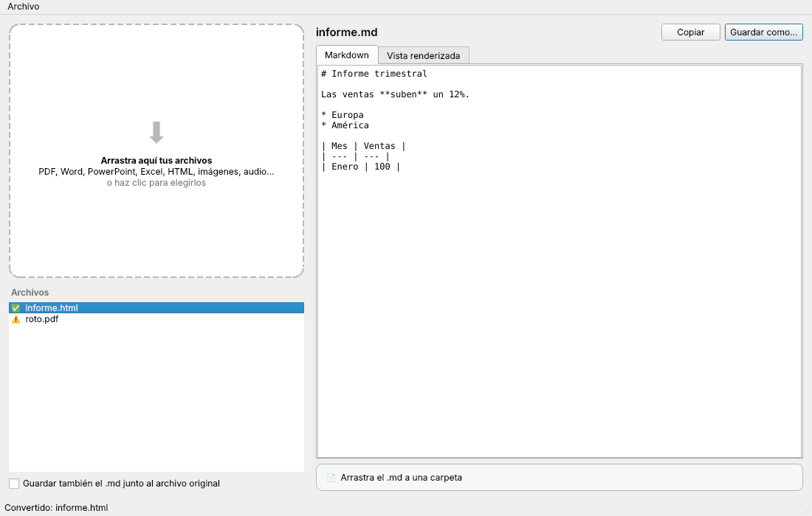

# MarkItDown Desktop

App de escritorio para macOS que convierte archivos a Markdown con
[MarkItDown](https://github.com/microsoft/markitdown), sin usar la terminal.

**Arrastra un archivo a la izquierda → el Markdown aparece a la derecha → arrástralo a la carpeta que quieras.**



## Qué hace

- **Soltar archivos** (o carpetas enteras) en el panel izquierdo, o hacer clic para elegirlos.
  También puedes soltarlos sobre el icono del Dock.
- Formatos: PDF, Word, PowerPoint, Excel, HTML, CSV, JSON, XML, EPUB, ZIP, imágenes (metadatos), audio (transcripción)…
- **Vista del Markdown** editable y vista renderizada.
- Tres formas de sacar el resultado:
  - **Arrastrar el `.md`** desde la barra inferior al Finder, al escritorio o a otra app.
  - **Guardar como…** (⌘S). Recuerda la última carpeta.
  - **Copiar** al portapapeles (⌘⇧C).
- Opción **"Guardar también el .md junto al archivo original"** (no sobrescribe: crea `nombre (1).md` si ya existe).
- La conversión va en segundo plano: la ventana nunca se congela.
- **No pierdes trabajo:** si cierras la app o vacías la lista con conversiones que no has guardado,
  copiado ni arrastrado a ninguna carpeta, te pregunta antes.

## Qué pasa con tus archivos

- **Originales:** la app solo los lee; nunca los mueve, copia ni borra.
- **Lista y Markdown en pantalla:** solo existen mientras la app está abierta.
- **Los `.md` que guardas o arrastras** se quedan donde los pusiste.
- **Copias temporales** (las que se crean al arrastrar el `.md` fuera de la app): se borran al cerrar la app.

## Instalación (sin Python)

1. Entra en la pestaña **Actions** del repositorio → la última ejecución en verde → descarga
   **MarkItDown-macOS** (o, si hay versiones publicadas, en **Releases**).
2. Abre el `.dmg` y arrastra **MarkItDown** a **Aplicaciones**.
3. La primera vez macOS avisará de que la app no es de un desarrollador identificado
   (no está firmada con una cuenta de Apple Developer). Para abrirla:
   - Clic derecho sobre la app → **Abrir** → **Abrir**; o bien
   - **Ajustes del Sistema → Privacidad y seguridad → "Abrir igualmente"**; o en Terminal:

     ```bash
     xattr -dr com.apple.quarantine /Applications/MarkItDown.app
     ```

La app compilada es para Macs con Apple Silicon (M1 o posterior).

## Ejecutar desde el código

```bash
python3 -m venv .venv
source .venv/bin/activate
pip install -e ".[dev]"
markitdown-desktop
```

## Desarrollo

```bash
pytest                                        # pruebas
pyinstaller packaging/MarkItDown.spec --noconfirm   # genera dist/MarkItDown.app
```

Para publicar una versión: crea una etiqueta `v0.1.0` y súbela; GitHub Actions adjunta el `.dmg` a la Release.

| Archivo | Qué contiene |
|---|---|
| `src/markitdown_desktop/converter.py` | Conversión con MarkItDown en segundo plano |
| `src/markitdown_desktop/drop_zone.py` | Panel izquierdo: soltar archivos y lista |
| `src/markitdown_desktop/preview.py` | Panel derecho: vista, copiar, arrastrar fuera |
| `src/markitdown_desktop/window.py` | Ventana principal, guardado y menú |
| `packaging/` | Empaquetado como `.app` (PyInstaller) e icono |
